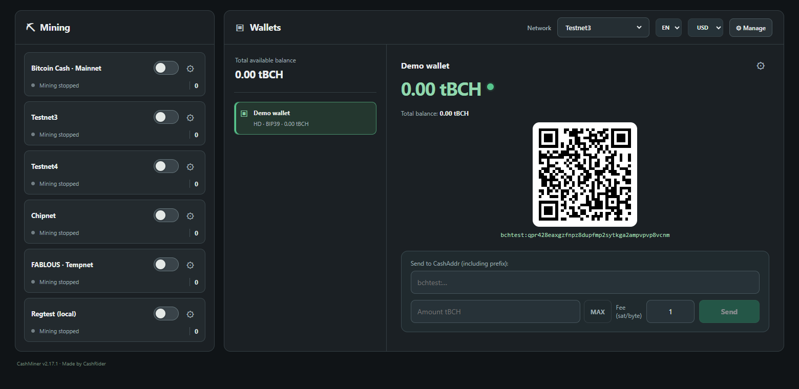
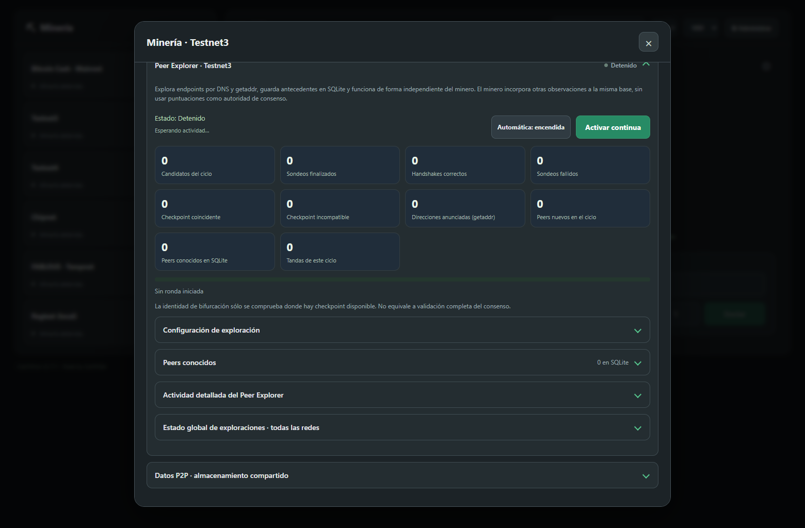

# CashMiner 💚

**Billetera y minero liviano para Bitcoin Cash**

**Miná, explorá, experimentá y aprendé sobre Bitcoin Cash. La minería P2P
directa permite empezar sin descargar toda la blockchain ni ejecutar tu
propio nodo completo.**

[English](README.md) · Versión **2.17.1** · **Windows x64** · **CPU / CUDA / OpenCL**

CashMiner es una billetera, minero y explorador de peers experimental de
CashRider, con licencia MIT. Puede conectarse directamente a la red P2P de
Bitcoin Cash, construir sus propios bloques, realizar prueba de trabajo y
difundir los resultados, sin un nodo completo local ni un pool en las redes
públicas compatibles.

Reúne herramientas desarrolladas a lo largo del tiempo mediante experimentación
personal y conocimientos compartidos por la comunidad Bitcoin Cash. Las redes
experimentales también permiten estudiar propuestas del protocolo, como los
experimentos con bloques de un minuto. Su propósito es poner las herramientas
para explorar, cuestionar y probar Bitcoin en manos de más personas.

[Descarga](#descarga-e-instalación) · [Funciones](#funciones) ·
[Redes](#redes-compatibles) · [Cómo funciona](#cómo-funciona) ·
[Ejecutar y compilar](#ejecutar-y-compilar-desde-el-código) ·
[Documentación y créditos](#documentación-y-créditos)



*Interfaz real con una billetera temporal de demostración de Testnet3, vacía.
La minería está detenida en la captura. No se muestran datos del usuario.*

## Descarga e instalación

**Windows x64 · ZIP candidato** — [Ver releases](https://github.com/MadSatCash/CashMiner/releases).

La candidata de Windows está adjunta a un borrador de release mientras se
completan las comprobaciones de distribución. Todavía no es una descarga
final publicada. El instalador es el siguiente paso del empaquetado.

Para ejecutar **CashMiner-Windows.zip**:

1. Extraé el ZIP **completo** en una carpeta propia.
2. Abrí `CashMiner/CashMiner.exe`.
3. Conservá `_internal`, las licencias y los demás archivos junto al EXE.

Python está incluido; no necesitás instalarlo por separado. Los controladores
GPU y un navegador instalado siguen siendo requisitos externos. Ver
[compatibilidad de Windows](#compatibilidad-de-windows).

## Funciones

- Minería con CPU, NVIDIA CUDA y GPU compatibles con OpenCL.
- Minería P2P directa con verificación nativa de cabeceras; Electrum asistido
  sigue disponible donde está implementado.
- RPC con un nodo BCH configurado: `getblocktemplate` / `submitblock`.
- Stratum V1 con un pool compatible configurado por el usuario.
- Sesiones independientes para Mainnet, Testnet3, Testnet4, Chipnet,
  FABLOUS Tempnet 2026 y Regtest local, con los requisitos de cada red.
- Billeteras, derivación HD, firma local, sincronización Electrum,
  herramientas de recuperación y respaldos.
- Observaciones de peers en SQLite por red, Peer Explorer y ranking
  precalculado en segundo plano para preparar candidatos iniciales.
- Fuentes P2P por red: DNS, SQLite o ambas.

## Redes compatibles

| Red | Propósito | Modalidades de minería |
| --- | --- | --- |
| Mainnet | Red pública de Bitcoin Cash | P2P nativo/asistido, RPC, Stratum |
| Testnet3 | Pruebas públicas | P2P nativo/asistido, RPC, Stratum |
| Testnet4 | Pruebas públicas | P2P nativo/asistido, RPC, Stratum |
| Chipnet | Pruebas de actualizaciones | P2P nativo/asistido, RPC, Stratum |
| FABLOUS Tempnet 2026 | Experimento de bloques más rápidos; corte de minería **15/11/2026 12:00 UTC** | P2P nativo, RPC, Stratum |
| Regtest | Pruebas locales con un nodo de prueba configurado | P2P nativo, RPC (modalidad inicial), Stratum |

El soporte de una modalidad describe la implementación, no la disponibilidad
de un servicio RPC público o un pool para cada red. RPC necesita un nodo
compatible configurado; Stratum necesita un pool compatible. La cobertura de
pruebas varía según red y backend. Los futuros cambios de consenso de Chipnet
requieren una revisión de compatibilidad independiente.

## Cómo funciona

En **P2P nativo**, CashMiner obtiene cabeceras de peers y comprueba checkpoints,
prueba de trabajo, dificultad y trabajo acumulado para seguir una rama conocida
de cabeceras. Construye un bloque candidato con la transacción de recompensa
(coinbase), entrega el trabajo al motor CPU/CUDA/OpenCL y difunde las soluciones.

Es verificación liviana de cabeceras: **no valida el consenso de bloques
completos ni reemplaza un nodo completo**. El constructor nativo actual genera
bloques sólo con coinbase; no recoge transacciones del mempool ni sus comisiones.
La billetera sigue sincronizando mediante Electrum. La referencia Electrum
asistida sigue disponible en las redes indicadas en la tabla.

En **RPC**, un nodo BCH configurado entrega plantillas y recibe los bloques
terminados. En **Stratum**, un pool compatible entrega trabajos y recibe shares.
Las modalidades utilizan los mismos backends de hashing; en Stratum las
recompensas y los pagos siguen las reglas del pool.

El **Peer Explorer** descubre endpoints y guarda observaciones en SQLite junto
con las aportadas por el minero. Un proceso separado prepara el ranking de
candidatos iniciales utilizando la política de selección existente. El ranking
y las puntuaciones son información de conectividad, no prueba de consenso.



*Peer Explorer real con una base temporal de demostración y sin un ciclo activo.
La interfaz permite seleccionar español o inglés.*

## Límites experimentales

- P2P nativo verifica cabeceras desde checkpoints; **no valida bloques completos
  ni sustituye un nodo completo**. Construye bloques sólo con coinbase, sin
  transacciones del mempool ni sus comisiones.
- P2P nativo no requiere tu propio nodo completo. La billetera sigue utilizando
  Electrum; RPC requiere un nodo propio o autorizado.
- Encontrar PoW, transmitir un bloque y observarlo en la cadena son resultados
  distintos. Ninguno por sí solo garantiza una recompensa gastable.
- La cobertura de validación varía según red, protocolo y hardware.
- Los candidatos se seleccionan al iniciar; no se actualizan dinámicamente
  durante la minería. El ranking puede estar desfasado respecto de observaciones.
- La minería FABLOUS Tempnet tiene corte programado el **15/11/2026 12:00 UTC**.
  No se promete compatibilidad automática con futuros cambios de Chipnet.
- Es software experimental para aprender y probar. La minería CPU/GPU no
  constituye una promesa de rentabilidad.

## Compatibilidad de Windows

Destino: Windows 10/11 x64 Intel/AMD. La candidata se probó en Windows 11;
la prueba en una instalación limpia sigue pendiente. CUDA/OpenCL requieren
controladores compatibles. La interfaz utiliza un navegador instalado
(preferentemente Edge, Chrome o Brave). El lanzador no tiene firma digital
del editor. Si falta `VCRUNTIME140.dll`, utilizá el Microsoft Visual C++
Redistributable x64 oficial.

No ejecutes pruebas contra los datos de tus billeteras reales. Dos copias
normalmente comparten el directorio de datos; no crean billeteras aisladas.

Windows x64 es el único sistema con una candidata empaquetada en esta versión.
Todavía no se ofrecen paquetes para Android, Linux, macOS ni iOS. Las
comprobaciones realizadas y pendientes están en [validación](docs/VALIDATION.md).

## Datos y recuperación

El programa y los datos personales se guardan por separado. En Windows se
utiliza normalmente `%LOCALAPPDATA%/CashMiner`; una instalación anterior en
`%LOCALAPPDATA%/CashMiner2` puede seguir utilizándose por compatibilidad.
El inicio no migra ni copia billeteras silenciosamente.

La protección de billeteras utiliza DPAPI de Windows. Conservá tus frases de
recuperación y respaldos: copiar el vault cifrado a otra computadora o cuenta
de Windows no reemplaza la recuperación. Nunca publiques frases, claves,
vaults ni contraseñas RPC/pool en issues. Ver [migración](docs/MIGRATION.md).

Para pruebas aisladas, configurá `CASHMINER_DATA_DIR` con una carpeta vacía
independiente antes de iniciar. El ZIP no contiene datos personales.

## Ejecutar y compilar desde el código

Con Python 3.10+ y una terminal en la raíz del repositorio:

```powershell
py -3 -m venv .venv
.venv\Scripts\python.exe -m pip install -r requirements.txt
.venv\Scripts\pythonw.exe CashMiner.pyw
```

El repositorio incluye las tres DLL de hashing Windows x64, sus fuentes y
checksums en `native/`. El paquete Python por sí solo no incluye toda la
aplicación: ejecutá desde el repositorio completo.

La compilación del ZIP autónomo está documentada en
[packaging/windows/README.md](packaging/windows/README.md).

## Desarrollo y pruebas

El runtime requiere `cryptography`; el paquete Windows también incorpora
`psutil`. Pillow se utiliza sólo para pruebas de recursos gráficos.

```powershell
.venv\Scripts\python.exe -m pip install Pillow
$env:PYTHONPATH = "$PWD\src"
.venv\Scripts\python.exe -X utf8 -m unittest discover -s tests
```

Las pruebas GPU y con nodos reales son optativas. Usá datos aislados y leé
las [notas de validación](docs/VALIDATION.md) antes de activarlas.

## Documentación y créditos

Gracias a la comunidad Bitcoin Cash y a las personas que comparten código,
herramientas, ideas y consejos. Los agradecimientos personales y las
atribuciones técnicas se detallan por separado en los documentos siguientes.

- [Arquitectura](docs/ARCHITECTURE.md)
- [Migración](docs/MIGRATION.md)
- [Validación](docs/VALIDATION.md)
- [Notas de versión](docs/RELEASE_NOTES.md)
- [Avisos de terceros](THIRD_PARTY_NOTICES.md)
- [Agradecimientos](ACKNOWLEDGEMENTS.md)

El código del proyecto de CashRider tiene [licencia MIT](LICENSE). Los
componentes de terceros conservan sus propias licencias y avisos. La licencia
del proyecto no cambia las condiciones de los drivers, SDK ni otros componentes
de sus proveedores.
