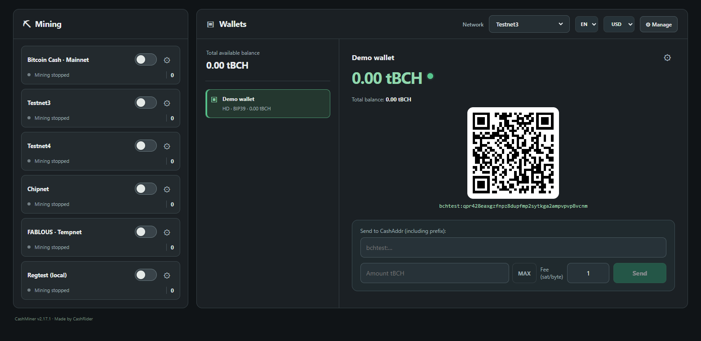
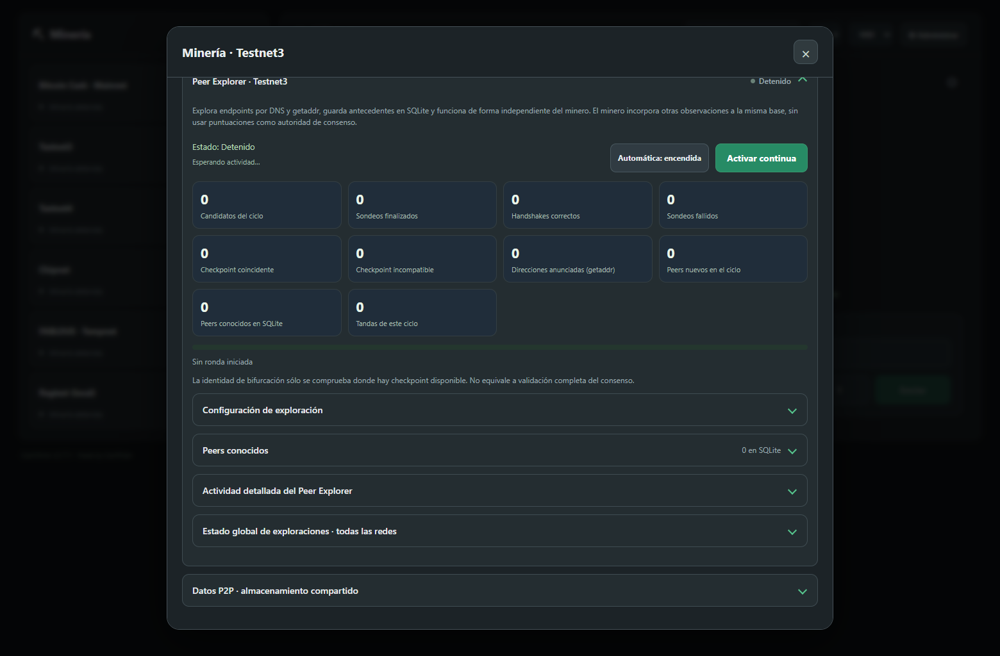

# CashMiner 💚

**Lightweight Bitcoin Cash Wallet & Miner**

**Mine, explore, experiment with and learn about Bitcoin Cash. Direct P2P
mining lets you get started without downloading the entire blockchain or
running your own full node.**

[Español](README.es.md) · Version **2.17.1** · **Windows x64** · **CPU / CUDA / OpenCL**

CashMiner is an experimental, MIT-licensed wallet, miner and peer explorer by
CashRider. It can connect directly to the Bitcoin Cash P2P network, construct
its own blocks, perform proof of work and broadcast the results, without a
local full node or mining pool on supported public networks.

It brings together tools developed over time through personal experimentation
and knowledge shared by the Bitcoin Cash community. Experimental networks
also provide a place to study protocol proposals, including experiments with
one-minute blocks. Its purpose is to put the tools to explore, question and test
Bitcoin into more people's hands.

[Download](#download-and-installation) · [Features](#features) ·
[Networks](#supported-networks) · [How it works](#how-it-works) ·
[Build from source](#build-from-source) · [Documentation and credits](#documentation-and-credits)



*Actual CashMiner interface with an isolated, empty Testnet3 demonstration
wallet. Mining is stopped in this screenshot; no user wallet data is shown.*

## Download and installation

**Windows x64 · ZIP candidate** — [View releases](https://github.com/MadSatCash/CashMiner/releases).

The Windows candidate is attached to a draft release while distribution
checks are completed. It is not yet a published final download. The installer
is the next packaging step.

To run **CashMiner-Windows.zip**:

1. Extract the **entire ZIP** to its own folder.
2. Open `CashMiner/CashMiner.exe`.
3. Keep `_internal`, licenses and the other packaged files beside the EXE.

Python is included; no separate Python installation is needed. GPU drivers
and an installed browser remain external requirements. See
[Windows compatibility](#windows-compatibility) for details.

## Features

- Mining with CPU, NVIDIA CUDA and compatible OpenCL GPUs.
- Direct P2P mining with native header verification; assisted Electrum
  reference remains selectable where implemented.
- RPC mining using a configured BCH node (`getblocktemplate` / `submitblock`).
- Stratum V1 mining using a compatible configured pool.
- Independent mining sessions for Mainnet, Testnet3, Testnet4, Chipnet,
  FABLOUS Tempnet 2026 and local Regtest, subject to each network's requirements.
- Wallets, HD address derivation, local transaction signing, Electrum
  synchronization, recovery tools and backups.
- Per-network SQLite peer observations, Peer Explorer and a background
  precalculated ranking for initial mining candidates.
- Per-network P2P sources: DNS, SQLite or both.

## Supported networks

| Network | Purpose | Mining modes |
| --- | --- | --- |
| Mainnet | Bitcoin Cash public network | Native/assisted P2P, RPC, Stratum |
| Testnet3 | Public testing | Native/assisted P2P, RPC, Stratum |
| Testnet4 | Public testing | Native/assisted P2P, RPC, Stratum |
| Chipnet | Upgrade testing | Native/assisted P2P, RPC, Stratum |
| FABLOUS Tempnet 2026 | Faster-block experiment; mining cutoff **2026-11-15 12:00 UTC** | Native P2P, RPC, Stratum |
| Regtest | Local testing with a configured test node | Native P2P, RPC (initial default), Stratum |

Mode support describes the implementation, not the availability of a public
RPC service or pool on every network. RPC needs a compatible node endpoint;
Stratum needs a compatible pool. Test coverage varies by network and backend.
Future Chipnet consensus changes require a separate compatibility review.

## How it works

In **native P2P mode**, CashMiner obtains headers from peers and checks
checkpoints, proof of work, difficulty and accumulated work to follow a known
header branch. It builds a candidate block with its reward transaction
(coinbase), gives the work to the shared CPU/CUDA/OpenCL engine and broadcasts
a solution to peers.

This is lightweight header verification, **not full-block consensus
validation or a replacement for a full node**. The current native builder
creates coinbase-only blocks; it does not collect mempool transactions/fees.
Wallet synchronization still uses Electrum servers. Assisted Electrum mining
remains selectable on the networks listed above.

In **RPC mode**, a configured BCH node supplies block templates and receives
completed blocks. In **Stratum mode**, a compatible pool supplies jobs and
receives shares. These modes use the same hashing backends; Stratum rewards
and payouts follow the pool's rules.

The **Peer Explorer** discovers endpoints and records observations in SQLite,
alongside observations from the miner. A separate ranking process prepares
initial candidates using the existing selection policy. Rankings and peer
scores are connectivity information, not proof of consensus validity.



*Actual Peer Explorer in an isolated demonstration database, with no cycle
running. The interface shown here is Spanish; English is also selectable.*

## Experimental limitations

- Native P2P verifies headers from checkpoints; it is **not full-block or
  full-node consensus validation**. The native P2P builder currently produces
  coinbase-only blocks, without mempool transactions/fees.
- Native P2P does not require your own full node. Wallet synchronization
  still uses Electrum servers; RPC requires your own or an authorized node.
- A found proof of work, a transmitted block and an observed chain inclusion
  are different results. None alone guarantees a spendable reward.
- Backend/protocol validation coverage varies by network and hardware.
- Candidates are selected initially; dynamic candidate refresh while mining
  is not implemented. Rankings can lag behind observations.
- FABLOUS Tempnet mining has a programmed cutoff at **2026-11-15 12:00 UTC**.
  Future Chipnet consensus changes are not automatically supported.
- This is experimental software, intended for learning and testing. CPU/GPU
  mining should not be treated as a promise of profitability.

## Windows compatibility

Target: Windows 10/11 x64 on Intel/AMD. The candidate has been tested on
Windows 11; a clean Windows installation check is still pending. Compatible
GPU drivers remain necessary for CUDA/OpenCL. The existing UI uses an
installed browser (Edge/Chrome/Brave preferred). The launcher is not
publisher-signed. If Windows reports a missing `VCRUNTIME140.dll`, use the
official Microsoft Visual C++ Redistributable x64.

Do not run tests or development copies against your live wallet data. Running
two copies normally uses the same data directory; they are not isolated wallets.

Only Windows x64 has a packaged candidate in this release. Android, Linux,
macOS and iOS packages are not provided yet. Completed and pending checks
are recorded in [validation notes](docs/VALIDATION.md).

## Data and recovery

Program files and personal data are separate. On Windows the normal data
directory is `%LOCALAPPDATA%/CashMiner`; an existing `%LOCALAPPDATA%/CashMiner2`
installation may continue to be used for compatibility. Startup does not
silently migrate or copy wallets.

Wallet protection uses Windows DPAPI. Preserve recovery phrases and backups;
copying an encrypted vault to a different Windows account/computer is not a
replacement for recovery. Never share recovery phrases, private keys, vaults
or RPC/pool passwords in issues. See [migration](docs/MIGRATION.md).

For isolated development, set `CASHMINER_DATA_DIR` to a separate empty folder
before starting the application. The Windows ZIP does not contain user data.

## Build from source

Use Python 3.10+ and a terminal in the repository root:

```powershell
py -3 -m venv .venv
.venv\Scripts\python.exe -m pip install -r requirements.txt
.venv\Scripts\pythonw.exe CashMiner.pyw
```

This source checkout includes the three Windows x64 hashing DLLs, their
sources and checksums under `native/`. The Python package alone does not
include the complete desktop application: run from the complete checkout.

To build the standalone Windows ZIP, see
[packaging/windows/README.md](packaging/windows/README.md).

## Development and checks

The runtime requires `cryptography`; the Windows bundle also includes
`psutil` for hardware/process support. Pillow is a test-only requirement for
visual asset checks. Standard-library SQLite is used for application data.

```powershell
.venv\Scripts\python.exe -m pip install Pillow
$env:PYTHONPATH = "$PWD\src"
.venv\Scripts\python.exe -X utf8 -m unittest discover -s tests
```

GPU and real-node tests are opt-in. Use isolated data and see
[validation notes](docs/VALIDATION.md) before enabling them.

## Documentation and credits

Thank you to the Bitcoin Cash community and the people who share code,
tools, ideas and advice. Personal acknowledgements and technical component
attributions are recorded separately below.

- [Architecture / Arquitectura](docs/ARCHITECTURE.md)
- [Migration / Migración](docs/MIGRATION.md)
- [Validation / Validación](docs/VALIDATION.md)
- [Release notes / Notas de versión](docs/RELEASE_NOTES.md)
- [Third-party notices](THIRD_PARTY_NOTICES.md)
- [Acknowledgements / Agradecimientos](ACKNOWLEDGEMENTS.md)

CashRider's project code is released under the [MIT License](LICENSE).
Third-party components retain their own licenses and notices. GPU drivers,
SDKs and other vendor components are not relicensed by the project license.
